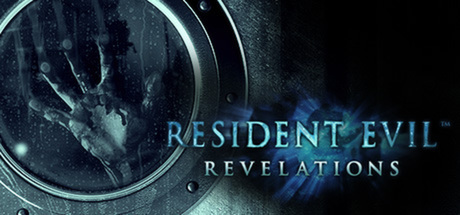

**Resident Evil Revelations is the atmospheric cruise ship survival horror featuring BSAA agents Chris Redfield and Jill Valentine. Originally a 3DS game expanded for console/PC, features the Genesis scanner for item searching and tight corridor horror.**

---

## 📖 About

Resident Evil Revelations is the atmospheric cruise ship survival horror featuring BSAA agents Chris Redfield and Jill Valentine. Originally a 3DS game expanded for console/PC, features the Genesis scanner for item searching and tight corridor horror.

## ⚠️ Problems Without Trainer

| Problem | Status |
|---------|--------|
| **Genesis Scanning** — Thorough scanning of every area for hidden items is time-intensive | ✅ Solved |
| **Unveiled Edition DLC** — Some characters and raid mode weapons locked behind paid content | ✅ Solved |
| **Parker Sections** — Flashback missions with Parker provide minimal combat options | ✅ Solved |
| **Raid Mode Grind** — Maxing all weapons in Raid Mode requires very extensive play | ✅ Solved |

## ✅ Solution

The **Resident Evil Revelations Trainer** solves all these issues by giving you complete control over the game.

## 🎯 Full Feature List

- Unlimited Resources
- God Mode / Invincibility
- Instant Skill Cooldown
- One-Hit Kill
- Freeze Game Timer
- Unlock All Items & Achievements
- Custom Speed Multiplier
- Save State Anywhere

## 🚀 Quick Start

1. **Disable Windows Defender** temporarily (trainer may trigger false positive)
2. Download the trainer from the button above
3. Launch Resident Evil Revelations
4. Run the trainer as Administrator
5. Activate desired cheats with hotkeys

## 💎 Free vs Paid

| Feature | Free | Pro |
|---------|------|-----|
| Basic God Mode | ✅ | ✅ |
| Unlimited Resources | ✅ | ✅ |
| All Advanced Cheats | ❌ | ✅ |
| Auto-Updates | ❌ | ✅ |
| Priority Support | ❌ | ✅ |

## 💻 Requirements

- Windows 10/11 (64-bit)
- Resident Evil Revelations (any version)
- .NET Framework 4.8+
- DirectX 11+

## 🍎 macOS

macOS users can use our alternative tool:

## ⚖️ Legal

This trainer is for educational and single-player use only. Use responsibly.

---

